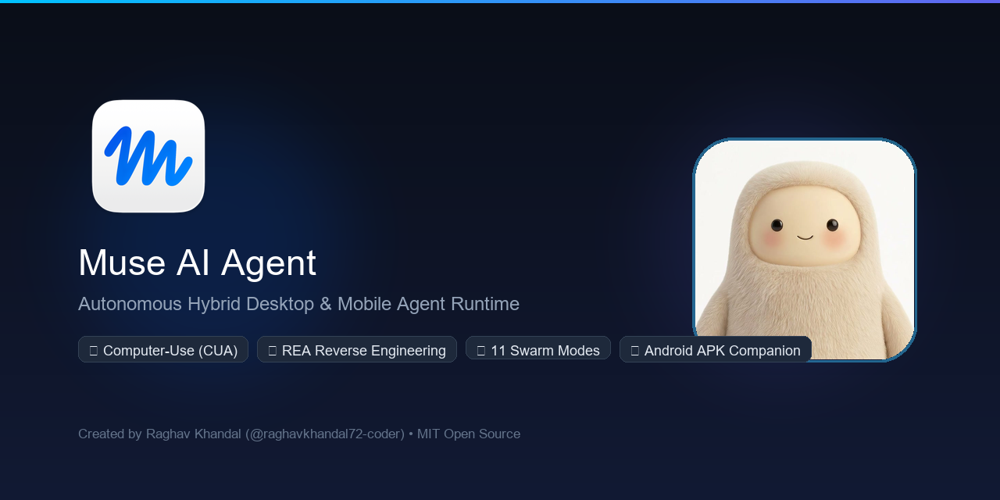
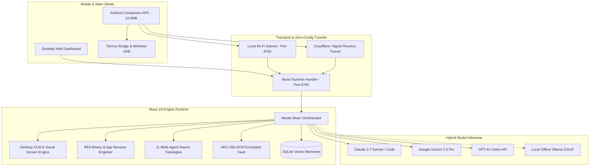

<div align="center">

<a href="https://github.com/raghavkhandal72-coder/muse-agent">
  
</a>

# ⚡ Muse Agent (muse-agent)
### Fifteen Engines. One Autonomous AI Agent.
**The Autonomous Hybrid Desktop & Mobile Agent Runtime by [Raghav Khandal (@raghavkhandal72-coder)](https://github.com/raghavkhandal72-coder)**

<p align="center">
  <b><a href="https://raghavkhandal72-coder.github.io/muse-agent/">🌐 Live Interactive Website</a></b> &bull;
  <b><a href="https://github.com/raghavkhandal72-coder/muse-agent/releases/latest">📱 Download Android APK</a></b> &bull;
  <b><a href="docs/SHOWCASE.md">🎬 Showcase Demos</a></b> &bull;
  <b><a href="ROADMAP.md">🗺️ Technical Roadmap</a></b>
</p>

<!-- Official Shields Matrix -->
<p align="center">
  <a href="https://github.com/raghavkhandal72-coder/muse-agent/stargazers"></a>
  <a href="https://github.com/raghavkhandal72-coder/muse-agent/network/members"></a>
  <a href="https://github.com/raghavkhandal72-coder/muse-agent/releases/latest"></a>
  <a href="https://github.com/raghavkhandal72-coder/muse-agent/actions"></a>
  <a href="https://pypi.org/project/muse-agent/"></a>
  <a href="https://github.com/raghavkhandal72-coder/muse-agent/releases"></a>
  <a href="LICENSE"></a>
</p>

<!-- Universal Agent Standard Badges -->
<p align="center">
  <a href="CLAUDE.md"></a>
  <a href=".cursorrules"></a>
  <a href=".windsurfrules"></a>
  <a href=".clinerules"></a>
  <a href=".github/copilot-instructions.md"></a>
  <a href="GEMINI.md"></a>
  <a href="AGENTS.md"></a>
</p>

<br />

<a href="https://raghavkhandal72-coder.github.io/muse-agent/">
  
</a>

<br />
<br />

**[⚡ 1-Minute Quickstart](#-1-minute-quickstart)** &bull;
**[📊 Why Muse Agent?](#-why-muse-agent)** &bull;
**[🧩 The 15 Engines](#-the-15-muse-engines)** &bull;
**[🖥️ Desktop CUA](#️-desktop-computer-use-cua)** &bull;
**[🔍 REA Reverse Engineering](#-rea-reverse-engineer-anything)** &bull;
**[🤖 11 Swarm Topologies](#-multi-agent-swarm-orchestrator)** &bull;
**[📱 Android APK](#-android-companion-apk--termux-bridge)** &bull;
**[🔌 17+ Connectors](#-17-production-connectors)** &bull;
**[📈 Star Growth](#-star-history--community)**

<br />

```bash
pip install muse-agent && muse run
```

<!-- GitHub Search & SEO Optimization -->
<p align="center">
  <b>Official Repository:</b> <code>raghavkhandal72-coder/muse-agent</code> &bull; 
  <b>Search Keywords:</b> <i>muse agent, muse agents, muse ai agent, meta muse, autonomous agent, computer use agent, cua, rea reverse engineering, android agent apk, raghav khandal</i>
</p>

</div>

---

> [!IMPORTANT]
> **Muse AI Agent** is an open-source, local-first runtime developed and maintained by **[Raghav Khandal (@raghavkhandal72-coder)](https://github.com/raghavkhandal72-coder)**.  
> Your passwords, browsing sessions, and memories stay **100% encrypted on your own machine** (`data/.vault_master.key`) without telemetry or cloud lock-in.

---

## 📊 Why Muse Agent?

How Muse Agent compares to other industry agent frameworks:

| Feature | ⚡ Muse Agent | OpenDevin / OpenHands | Claude Computer Use | AutoGPT |
| :--- | :---: | :---: | :---: | :---: |
| **Desktop CUA (Mouse, Keyboard, Vision)** | **✅ Native (Win/Mac/Linux)** | ⚠️ Docker Sandbox Only | ⚠️ Cloud Only | ❌ No |
| **Reverse Engineering Engine (REA)** | **✅ 200,000★ Built-in** | ❌ No | ❌ No | ❌ No |
| **Native Android Companion APK** | **✅ 13.5 MB APK + Termux** | ❌ No | ❌ No | ❌ No |
| **Multi-Agent Swarm Topologies** | **✅ 11 Pre-Built Topologies** | ⚠️ Basic | ❌ Single Turn | ⚠️ Basic |
| **Zero-Config Remote Access** | **✅ Ngrok & Cloudflare** | ❌ Manual Port Forward | ❌ Cloud API Only | ❌ No |
| **Production App Connectors** | **✅ 17+ OAuth Bridges** | ⚠️ Git & Shell only | ❌ None | ⚠️ Limited |
| **100% Local / Offline LLM (Ollama)** | **✅ Full GGUF Support** | ⚠️ Partial | ❌ Cloud Only | ⚠️ Partial |
| **Local Zero-Knowledge Vault** | **✅ AES-256-GCM** | ❌ Plaintext Env | ❌ No | ❌ Plaintext Env |
| **1-Click Launchers (BAT / Shell)** | **✅ Included** | ❌ Docker Compose only | ❌ Python Script | ❌ Shell Script |

---

## ⚡ 1-Minute Quickstart

### Option 1: 1-Click Launchers (Easiest)
* **Windows**: Double-click [`Start_Muse.bat`](Start_Muse.bat)
* **Linux / macOS**: Run `./start_muse.sh`

### Option 2: Python CLI (Recommended for Developers)
```bash
# 1. Install via pip
pip install muse-agent

# 2. Run system doctor to verify display & drivers
muse doctor

# 3. Launch interactive Muse Agent
muse run
```

### Option 3: Docker Container Suite
```bash
docker compose up -d
# Muse CUA with Xvfb virtual display buffer is now running at http://localhost:8765
```

---

## 🧩 The 15 Muse Engines

Muse is built as a modular multi-engine architecture where each subsystem handles specialized execution:

| Icon | Engine | Architecture & Purpose |
| :---: | :--- | :--- |
| 🖥️ | **CuaAgent** | Coordinate-accurate desktop click, text typing, multi-monitor screenshot capture via PyAutoGUI & Vision. |
| 🔍 | **ReaBinary** | Integrated 200k-star REA toolchain for inspecting Electron/Node apps, binaries, and crypto protocols. |
| 📱 | **AndroidBridge** | Native Android APK with Termux shell bridge, hands-free wake-word voice, and wireless ADB automation. |
| 🤖 | **SwarmMesh** | 11 collaborative multi-agent topologies (CrewAI teams, LangGraph cyclic graphs, AutoGen debate). |
| 🔒 | **LocalVault** | Zero-knowledge AES-256-GCM encrypted credential vault with master password protection. |
| 🦙 | **OllamaLocal** | 100% offline local LLM inference for Llama 3.3, Mistral, Qwen, and Gemma models. |
| 🎙️ | **VoiceWake** | Real-time continuous background microphone listener with wake-word and native Android/Desktop TTS. |
| 🔌 | **ConnectHub** | 17+ built-in production connectors for GitHub, Gmail, WhatsApp, Slack, Discord, Notion, Spotify. |
| 🌐 | **BrowserEye** | Headless and visual browser automation with Playwright/Puppeteer DOM parsing and visual auditing. |
| 🧠 | **MemoryCore** | Episodic and semantic long-term memory engine backed by SQLite and dense vector embeddings. |
| ⚡ | **TunnelZero** | Automated Ngrok and Cloudflare reverse tunnel daemons for secure out-of-the-box mobile remote access. |
| 💻 | **CliRunner** | Production developer CLI with interactive session, status inspection, and doctor diagnostics. |
| 👁️ | **VisionEye** | Multimodal visual reasoning engine supporting Gemini 2.5 Pro, Claude 3.7 Sonnet, and GPT-4o. |
| 🛠️ | **DevCoder** | Multi-file codebase synthesis, linting, self-healing test repair, and automated git workflows. |
| 🐳 | **DockerStack** | Containerized headless deployment with virtual Xvfb display and companion Ollama stack. |

---

## 🖥️ Desktop Computer-Use (CUA)

Muse can autonomously control any desktop application just like a human engineer:

```python
from tools import cua_click_coordinate, cua_type_text, cua_take_screenshot

# Take a screenshot of the multi-monitor desktop
screenshot_b64 = cua_take_screenshot()

# Click a button coordinate identified by vision model
cua_click_coordinate(x=450, y=720, button="left")

# Type terminal commands or document text
cua_type_text(text="git status", press_enter=True)
```

---

## 🔍 REA: Reverse Engineer Anything

Native integration with the **200,000-star REA toolchain**:
- **App Inspection**: Decompile and inspect Electron, JavaScript, and native desktop binaries.
- **Protocol Verification**: Real-time inspection of API calls, WebSocket payloads, and encryption routines.
- **Automated Verification**: Run REA Doctor directly within Muse:
  ```bash
  python scripts/test_runner.py
  ```

---

## 🤖 Multi-Agent Swarm Orchestrator

Access 11 specialized autonomous orchestration engines via `/api/brain/orchestrate`:

| Engine ID | Name | Execution Pipeline |
| :--- | :--- | :--- |
| `crewai_swarm` | CrewAI Swarm | 3-agent team (Lead Researcher, Principal Engineer, QA Lead) generating verified async tasks. |
| `langgraph_workflow` | LangGraph State Machine | Cyclic state graph with deterministic guardrails and checkpoint verification. |
| `autogen_debate` | AutoGen Debate Arena | 3-agent arena (Architect, Critic, Dev) synthesizing resilient implementations. |
| `storm_research` | Stanford STORM Academic | Multi-perspective retrieval compiling cited Wikipedia-style technical papers. |
| `notebooklm_audio` | NotebookLM Audio Deep-Dive | 2-host conversational script (Alex & Sam) synthesized for mobile Android TTS. |
| `system_design_101` | ByteByteGo System Design | Distributed microservice blueprints, edge-pairing, and circuit-breaker specs. |
| `youtube_automation` | YouTube Video Pipeline | High-CTR titles, 60-second Shorts scripts with B-roll/audio timecodes, and SEO tags. |
| `claude_seo_marketing` | Claude SEO & Marketing | Content gap analysis, long-tail keyword clusters, and meta-strategy blueprints. |
| `ecc_performance` | ECC Benchmark | Low-latency profiler, token-throughput harness, and hardware optimization. |
| `munder_difflin_office` | Munder-Difflin Office | Simulation of multi-department enterprise workflows and role-based tasks. |
| `fonoster_sip_voice` | Fonoster SIP Telephony | Programmable IVR call trees, audio streaming, and voice agent routing. |

---

## 📱 Android Companion APK & Termux Bridge

Muse pairs with an Android phone via [`com.muse.agent`](https://github.com/raghavkhandal72-coder/muse-agent/releases) (13.57 MB):
- **Voice Agent**: Hands-free voice recognition with native Android Text-to-Speech (TTS).
- **Termux Shell Dispatch**: Executes system scripts directly in Termux using `com.termux.RUN_COMMAND`.
- **Wireless ADB / Shizuku**: Tap, swipe, open apps, and automate Android UI elements wirelessly.
- **Three Connection Modes**: Local LAN (`:8765`), Cloud Tunnel HTTPS, or 100% Offline Mode.

---

## 🔌 17+ Production Connectors

Built-in consent and OAuth RPC callback handlers for 17 popular platforms:

| Connector | Category | Protocol / Capabilities | Status |
| :--- | :--- | :--- | :---: |
| **GitHub** | Developer | Repository management, commits, issues, PR review | 🟢 Active |
| **Gmail** | Productivity | Read, search, draft, and send emails via OAuth2 | 🟢 Active |
| **Google Drive** | Storage | File upload, search, document syncing | 🟢 Active |
| **Google Calendar** | Productivity | Event scheduling, reminders, availability checking | 🟢 Active |
| **WhatsApp** | Messaging | Web/Noise protocol session login and message dispatch | 🟢 Active |
| **Telegram** | Messaging | Bot API, channel monitoring, interactive replies | 🟢 Active |
| **Slack** | Collaboration | Webhook & Bot user messaging, thread management | 🟢 Active |
| **Discord** | Community | Webhook automation, server alerts, command triggers | 🟢 Active |
| **Spotify** | Entertainment | Playback control, playlist management, search | 🟢 Active |
| **Notion** | Knowledge | Database queries, page creation, notes sync | 🟢 Active |
| **Trello** | Task Management | Board management, card updates, workflow movement | 🟢 Active |
| **Jira** | Project Management | Issue tracking, sprint updates, ticket creation | 🟢 Active |
| **Linear** | Engineering | Issue tracking, cycle management, developer triage | 🟢 Active |
| **Asana** | Productivity | Task assignments, project tracking, milestone updates | 🟢 Active |
| **Todoist** | Personal Tasks | Daily checklist sync, priority setting, reminders | 🟢 Active |
| **Dropbox** | Cloud Storage | Secure file upload and public link generation | 🟢 Active |
| **OneDrive** | Cloud Storage | Microsoft 365 cloud file sync and document access | 🟢 Active |

---

## 🏗️ System Architecture



---

## 🤝 Contributing & Community

Contributions are warmly welcomed! Please read our [Contributing Guidelines](CONTRIBUTING.md) and [Code of Conduct](CODE_OF_CONDUCT.md).

1. Fork the Project (`https://github.com/raghavkhandal72-coder/muse-agent/fork`)
2. Create your Feature Branch (`git checkout -b feature/AmazingEngine`)
3. Test your code (`python scripts/test_runner.py`)
4. Commit your Changes (`git commit -m 'feat: add AmazingEngine'`)
5. Push to the Branch (`git push origin feature/AmazingEngine`)
6. Open a Pull Request

---

## 📜 Citation

```bibtex
@software{khandal2026muse,
  author = {Khandal, Raghav},
  title = {Muse Agent: Autonomous Hybrid Desktop and Mobile Agent Runtime},
  url = {https://github.com/raghavkhandal72-coder/muse-agent},
  version = {1.0.0},
  year = {2026}
}
```

---

## 📈 Star History & Community

Support open-source autonomous AI! If you find Muse Agent exciting, **please star the repository** — it helps more developers discover the runtime and fuels ongoing development.

<p align="center">
  <a href="https://star-history.com/#raghavkhandal72-coder/muse-agent&Date">
    
  </a>
</p>

<p align="center">
  <a href="https://github.com/raghavkhandal72-coder/muse-agent/stargazers">
    
  </a>
</p>

---

## 📄 License

Distributed under the **MIT License**. See [`LICENSE`](LICENSE) for details.

<div align="center">
  <b>Architected with ❤️ by <a href="https://github.com/raghavkhandal72-coder">Raghav Khandal (@raghavkhandal72-coder)</a></b><br>
  <i>⭐ One agent. Infinite capability. Star us on GitHub! ⭐</i>
</div>
