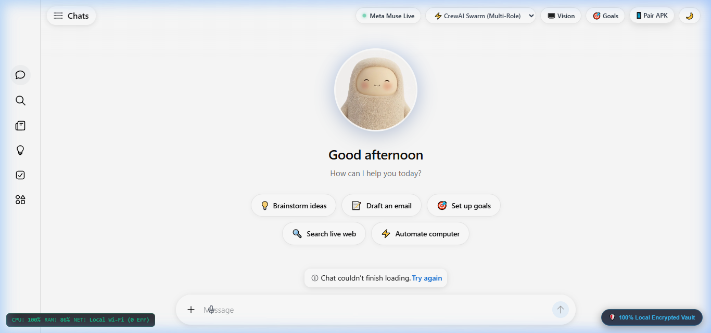
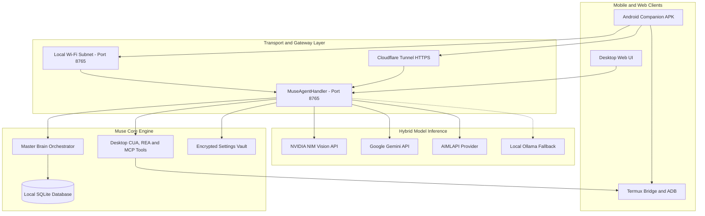

<div align="center">

**English** · [हिन्दी](README.md) · [简体中文](README.md) · [日本語](README.md) · [Deutsch](README.md) · [Español](README.md) · [Français](README.md)

<br />

<a href="https://github.com/raghavkhandal72-coder/muse-agent">
  
</a>

# Muse: Autonomous Hybrid Desktop & Mobile Agent Runtime

### One MCP & Runtime for Computer-Use, Reverse Engineering, Swarm Orchestration, and Android Control.

**See any desktop task or mobile routine. Automate, reverse-engineer, and master it down to the system level.**

<br />

[](https://github.com/raghavkhandal72-coder/muse-agent/stargazers)
[](https://github.com/raghavkhandal72-coder/muse-agent/network/members)
[](https://github.com/raghavkhandal72-coder/muse-agent/actions)
[](https://modelcontextprotocol.io/)
[](skills/reverse-engineer-anything/SKILL.md)
[-339933?style=flat-square&logo=android&logoColor=white)](https://github.com/raghavkhandal72-coder/muse-agent/releases)
[](LICENSE)

<br />

**[⚡ Quickstart](#-quick-start) · [✨ Features](#-what-muse-can-do) · [🔍 REA Skill](#-rea-reverse-engineering) · [🏗️ Architecture](#-system-architecture) · [🤖 Swarms](#-multi-agent-swarm-orchestrator) · [📱 Mobile APK](#-android-companion-apk) · [🔌 Connectors](#-17-production-connectors)**

<br />

```bash
git clone https://github.com/raghavkhandal72-coder/muse-agent.git && cd muse-agent && pip install -r requirements.txt && python main.py
```

<br />



<br />

</div>

> [!IMPORTANT]
> **Muse AI Agent** is created by **[Raghav Khandal (@raghavkhandal72-coder)](https://github.com/raghavkhandal72-coder)**.
> All personal memories, passwords, and model cache remain **100% local and encrypted** on your own hardware (`data/.vault_master.key`).

---

## 🔍 REA: Reverse Engineer Anything Integration

Muse AI Agent natively embeds the **[REA (Reverse Engineer Anything)](https://github.com/morluto/rea)** toolchain and skill manifest (`skills/reverse-engineer-anything/SKILL.md`):

- **Binary & App Inspection**: Inspect Electron ASAR archives, JavaScript single-page applications, and native executable headers.
- **Crypto & Protocol Health Check**: Built-in test harness verifying AES-256-GCM, SHA-256 hashing, and WebSocket RPC framing (`rea-inspector/lib/doctor.js`).
- **Bridge with Computer-Use Agent**: Seamlessly inspect UI component trees, extract coordinates, and dispatch automated routines.

```bash
# Run the built-in REA Doctor Diagnostic Suite
node -e "console.log(require('./rea-inspector/lib/doctor').runDoctor())"
```

---

## ⚡ Quick Start

### 1. Launch Muse Desktop & Server
```bash
# Clone the repository
git clone https://github.com/raghavkhandal72-coder/muse-agent.git
cd muse-agent

# Install dependencies
pip install -r requirements.txt

# Run Muse Agent (Desktop UI + Server on port 8765)
python main.py
```

### 2. Headless Mode (Servers, Termux, Docker)
```bash
python main.py --headless
```

---

## ✨ What Muse Can Do

| Capability | Module | Description |
| :--- | :--- | :--- |
| 🖥️ **Computer-Use Agent (CUA)** | `tools.py` | Full desktop autonomy: take screenshots, click coordinates, type text, and press hotkeys. |
| 🔍 **REA Reverse Engineering** | `rea-inspector/` | Inspect apps, trace runtime crypto protocols, and verify binary system toolchains. |
| 🤖 **Multi-Agent Swarm** | `muse_master_brain.py` | 11 specialized agent modes (CrewAI swarms, LangGraph state machines, AutoGen debate, STORM research). |
| 📱 **Android Companion APK** | `com.muse.agent` | 13.5 MB native Android app with Termux shell bridge, wake-word voice, and wireless ADB control. |
| 🌐 **Zero-Config Remote Tunnel** | `tunnel_manager.py` | Cloudflare Tunnel daemon providing instant public HTTPS access (`*.trycloudflare.com`). |
| 🔒 **Local Encrypted Vault** | `settings_manager.py` | AES-256 encrypted storage (`data/.vault_master.key`) for credentials, memories, and user goals. |

---

## 🏗️ System Architecture



---

## 🤖 Multi-Agent Swarm Orchestrator

Access 11 specialized autonomous orchestration engines via `/api/brain/orchestrate`:

| Engine ID | Name | Execution Pipeline |
| :--- | :--- | :--- |
| `crewai_swarm` | CrewAI Swarm | 3-agent team (Lead Researcher, Principal Engineer, QA Lead) generating verified async tasks. |
| `langgraph_workflow` | LangGraph State Machine | Cyclic state graph with deterministic guardrails and checkpoint verification. |
| `autogen_debate` | AutoGen Debate Arena | 3-agent arena (Architect, Critic, Dev) synthesizing resilient implementations. |
| `storm_research` | Stanford STORM Academic | Multi-perspective retrieval compiling cited Wikipedia-style technical papers. |
| `notebooklm_audio` | NotebookLM Audio Deep-Dive | 2-host conversational script (Alex & Sam) synthesized for mobile Android TTS. |
| `system_design_101` | ByteByteGo System Design | Distributed microservice blueprints, edge-pairing, and circuit-breaker specs. |
| `youtube_automation` | YouTube Video Pipeline | High-CTR titles, 60-second Shorts scripts with B-roll/audio timecodes, and SEO tags. |
| `claude_seo_marketing` | Claude SEO & Marketing | Content gap analysis, long-tail keyword clusters, and meta-strategy blueprints. |
| `ecc_performance` | ECC Benchmark | Low-latency profiler, token-throughput harness, and hardware optimization. |
| `munder_difflin_office` | Munder-Difflin Office | Simulation of multi-department enterprise workflows and role-based tasks. |
| `fonoster_sip_voice` | Fonoster SIP Telephony | Programmable IVR call trees, audio streaming, and voice agent routing. |

---

## 📱 Android Companion APK & Termux Bridge

Muse pairs with an Android phone via `com.muse.agent` (13.57 MB):
- **Voice Agent**: Hands-free voice recognition with native Android Text-to-Speech (TTS).
- **Termux Shell Dispatch**: Executes system scripts directly in Termux using `com.termux.RUN_COMMAND`.
- **Wireless ADB / Shizuku**: Tap, swipe, open apps, and automate Android UI elements wirelessly.
- **Three Connection Modes**: Local LAN (`:8765`), Cloudflare Tunnel HTTPS, or 100% Offline Mode.

---

## 🔌 17 Production Connectors

Built-in consent and OAuth RPC callback handlers for 17 popular platforms:

| Connector | Category | Protocol / Capabilities | Status |
| :--- | :--- | :--- | :---: |
| **GitHub** | Developer | Repository management, commits, issues, PR review | 🟢 Active |
| **Gmail** | Productivity | Read, search, draft, and send emails via OAuth2 | 🟢 Active |
| **Google Drive** | Storage | File upload, search, document syncing | 🟢 Active |
| **Google Calendar** | Productivity | Event scheduling, reminders, availability checking | 🟢 Active |
| **WhatsApp** | Messaging | Web/Noise protocol session login and message dispatch | 🟢 Active |
| **Telegram** | Messaging | Bot API, channel monitoring, interactive replies | 🟢 Active |
| **Slack** | Collaboration | Webhook & Bot user messaging, thread management | 🟢 Active |
| **Discord** | Community | Webhook automation, server alerts, command triggers | 🟢 Active |
| **Spotify** | Entertainment | Playback control, playlist management, search | 🟢 Active |
| **Notion** | Knowledge | Database queries, page creation, notes sync | 🟢 Active |
| **Trello** | Task Management | Board management, card updates, workflow movement | 🟢 Active |
| **Jira** | Project Management | Issue tracking, sprint updates, ticket creation | 🟢 Active |
| **Linear** | Engineering | Issue tracking, cycle management, developer triage | 🟢 Active |
| **Asana** | Productivity | Task assignments, project tracking, milestone updates | 🟢 Active |
| **Todoist** | Personal Tasks | Daily checklist sync, priority setting, reminders | 🟢 Active |
| **Dropbox** | Cloud Storage | Secure file upload and public link generation | 🟢 Active |
| **OneDrive** | Cloud Storage | Microsoft 365 cloud file sync and document access | 🟢 Active |

---

## 🤝 Contributing

Contributions are warmly welcomed! Please read our [Contributing Guidelines](CONTRIBUTING.md) to get started.

1. Fork the Project (`https://github.com/raghavkhandal72-coder/muse-agent/fork`)
2. Create your Feature Branch (`git checkout -b feature/AmazingFeature`)
3. Commit your Changes (`git commit -m 'feat: add AmazingFeature'`)
4. Push to the Branch (`git push origin feature/AmazingFeature`)
5. Open a Pull Request

---

## 📜 Citation

```bibtex
@software{khandal2026muse,
  author = {Khandal, Raghav},
  title = {Muse AI Agent: Autonomous Hybrid Desktop and Mobile Agent Runtime},
  url = {https://github.com/raghavkhandal72-coder/muse-agent},
  version = {1.0.0},
  year = {2026}
}
```

---

## 📄 License

Distributed under the **MIT License**. See [`LICENSE`](LICENSE) for details.

<div align="center">
  <b>Created with ❤️ by <a href="https://github.com/raghavkhandal72-coder">Raghav Khandal (@raghavkhandal72-coder)</a></b><br>
  <i>⭐ If you find Muse Agent useful, please give it a star on GitHub! ⭐</i>
</div>
